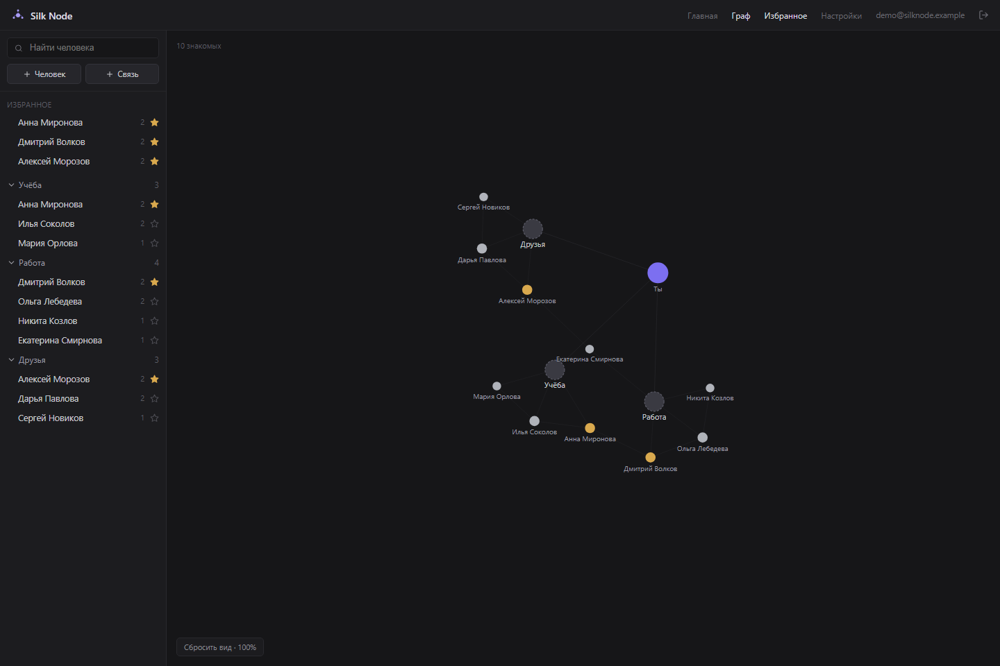
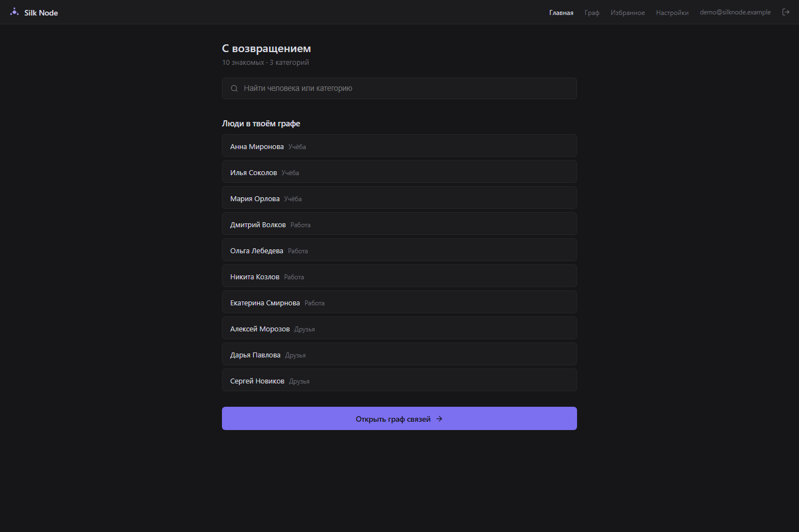
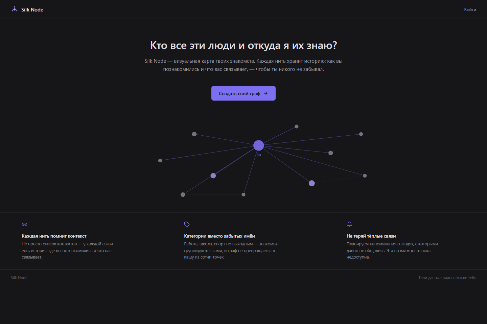
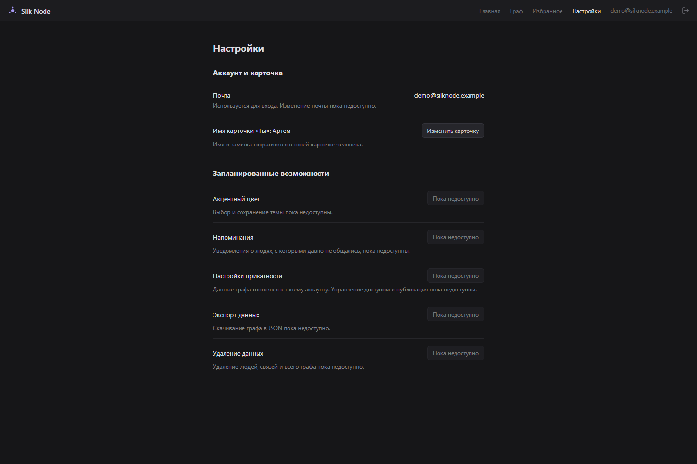

# Silk Node

**Визуальная карта знакомств: кто эти люди, откуда ты их знаешь и как они связаны между собой.**

Silk Node помогает хранить контекст общения: добавлять людей, записывать заметки,
отмечать избранных и собирать своё окружение в интерактивный граф. Этот репозиторий
содержит фронтенд приложения, который работает с отдельным FastAPI-бэкендом.



## Возможности

- Регистрация, вход и восстановление сессии после перезагрузки.
- Создание и редактирование карточек людей: имя, заметка, избранное.
- Создание и редактирование связей между людьми с описанием контекста.
- Интерактивный граф: перетаскивание узлов, масштабирование, поиск и фокус на окружении человека.
- Группировка знакомых по прямым связям с владельцем графа: например, учёба, работа и друзья.
- Главная страница со списком людей, поиском и количеством категорий.
- Кеш данных на 60 секунд: переходы между страницами используют свежие данные без повторных запросов.
- Состояния загрузки, ошибок и пустого графа; сохранение введённых данных при неудачном запросе.

## Скриншоты

Скриншоты сняты с работающего интерфейса. Контакты и аккаунт на изображениях —
демонстрационные; для съёмки ответы API подменены вымышленными данными.

<details>
<summary>Главная страница — список людей и поиск</summary>



</details>

<details>
<summary>Лендинг</summary>



</details>

<details>
<summary>Настройки и карточка владельца графа</summary>



</details>

## Технологии

| Инструмент | Для чего используется |
|---|---|
| React 18 | Компоненты интерфейса и состояние приложения |
| Vite 5 | Локальный сервер и production-сборка |
| React Router 6 | Маршруты и проверка доступа к страницам |
| TanStack Query 5 | Загрузка, кеширование и изменение серверных данных |
| D3 7 | Расположение узлов графа, масштабирование и перемещение |
| Lucide React | Иконки |
| Fetch API | HTTP-запросы к бэкенду |

Интерфейс написан на JavaScript и JSX. Палитра и общие стили кнопок находятся
в `src/theme.js`, базовые стили — в `src/index.css`.

## Локальный запуск

Для полного приложения нужен отдельно запущенный бэкенд с настроенной БД
и миграциями. Фронтенд локально проверялся на Node.js 24.

1. Установи зависимости:

   ```sh
   npm ci
   ```

2. Создай `.env.local` по примеру `.env.example`:

   ```dotenv
   VITE_API_BASE_URL=http://localhost:8000
   ```

3. Запусти фронтенд:

   ```sh
   npm run dev
   ```

4. Открой **http://localhost:5173**.

Адрес API по умолчанию — `http://localhost:8000`. После изменения `.env.local`
перезапусти Vite. Используй одинаковый hostname для фронтенда и API — `localhost`.
Бэкенд при этом может слушать `127.0.0.1:8000`.

Для cookies бэкенд должен разрешать CORS с `http://localhost:5173` и передачу
учётных данных (`allow_credentials=True`). Без бэкенда доступен публичный лендинг;
вход и страницы с графом требуют API.

## Сборка и команды

| Команда | Действие |
|---|---|
| `npm run dev` | Запустить локальный сервер |
| `npm run build` | Собрать приложение в `dist/` |
| `npm run preview` | Просмотреть production-сборку локально |
| `npm test` | Запустить автоматические тесты API-клиента и создания карточки «Ты» |
| `npm run test:browser -- --real` | Проверить интерфейс в браузере с настоящим API |

Браузерная проверка требует Node.js 22+ с глобальным WebSocket, Chrome или Edge,
доступный API и собранный `dist/`. Путь к браузеру можно задать через `CHROME_PATH`.
Сценарий создаёт отдельные тестовые аккаунты, людей и связи; запускай его на тестовом
API. Данные останутся на сервере, поскольку удаления пока нет. Для отдельных
сценариев ошибок ответы намеренно подменяются через DevTools Protocol.

Результаты проверок и особенности тестовой среды описаны в
[FRONTEND_VALIDATION.md](FRONTEND_VALIDATION.md).

## Структура проекта

```text
src/
  api/          # HTTP-клиент, создание карточки «Ты», контроль смены сессии
  components/   # Навигация, кнопки, модальные формы и состояния запросов
  context/      # Авторизация и текущий пользователь
  hooks/        # Люди, связи и данные для графа
  pages/        # Лендинг, вход, регистрация, главная, граф и настройки
  App.jsx       # Маршруты и защита внутренних страниц
  main.jsx      # Точка входа и провайдеры
  theme.js      # Общая палитра и стили кнопок
docs/
  screenshots/  # Скриншоты для README
scripts/
  browser-check.mjs
tests/
  api.test.mjs
```

## Работа с API

Авторизация использует серверные cookies. Каждый запрос отправляется с
`credentials: "include"`; фронтенд не сохраняет JWT в localStorage.
При загрузке приложения и после входа или регистрации вызывается `GET /users/me`.
Внутренние страницы `/home`, `/graph` и `/settings` доступны авторизованному пользователю.

| Действие | Запрос |
|---|---|
| Регистрация / вход / выход | `POST /auth/register`, `/auth/login`, `/auth/logout` |
| Текущий пользователь | `GET /users/me` |
| Список людей | `GET /person` |
| Создание человека | `POST /person/create` |
| Изменение человека | `PATCH /person?person_id=ID` |
| Список связей | `GET /connections` |
| Создание связи | `POST /connections/create` |
| Изменение связи | `PATCH /connections?connection_id=ID` |

Создание человека отправляет `name`, `note`, `is_self`, `is_favourite`.
Создание связи использует `person_id_a` и `person_id_b`, а ответы и PATCH —
`person_a_id` и `person_b_id`. Поле `via` хранит описание связи.
PATCH отправляет только изменённые поля. Дубликат связи возвращает `409`.

Карточка «Ты» соответствует реальному Person с `is_self: true`. Если её нет,
клиент создаёт карточку. Если другой браузер успел создать её одновременно,
фронтенд обрабатывает `409` и перечитывает список.

Кеш людей и связей хранится только в памяти, с ключами по ID пользователя и
`staleTime: 60_000`. Успешные POST/PATCH обновляют кеш из ответа сервера,
включая отсортированную пару участников связи. Выход очищает кеш; поздние
ответы старой сессии не попадают в данные нового аккаунта.
